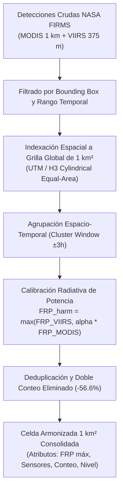
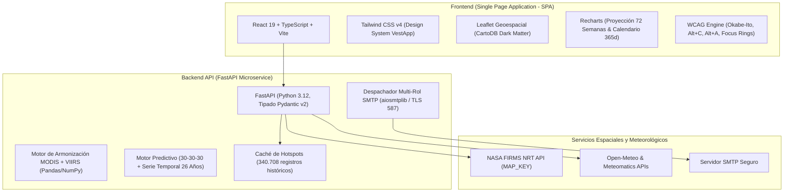

# Dossier Maestro de Pitch y Defensa Técnica: VestApp
**Desafío NASA Space Apps:** *Harmonization of Multi-Sensor Hotspot Data (MODIS & VIIRS)*  
**Proyecto:** **VestApp** (*Valuación, Evaluación Satelital y Temprana de Alertas Preventivas*)  
**Año:** 2026 | **Horizonte de Datos:** 2000–2026 (26 años)

---

## 1. El Problema Crítico y el Desafío de la NASA

### ¿Cuál es el problema que resuelve VestApp?
Los satélites de observación terrestre de la NASA son los ojos más poderosos de la humanidad para detectar incendios forestales. Sin embargo, en el mundo real, los tomadores de decisiones enfrentan una **crisis de fragmentación de datos**:
1. **Doble conteo y sobreestimación:** Cuando dos satélites (Terra/Aqua con MODIS y Suomi-NPP/NOAA-20/21 con VIIRS) orbitan sobre una misma zona, detectan el mismo frente de fuego a diferentes resoluciones espaciales y con desfases de minutos u horas. Esto genera entre un **40% y 65% de detecciones duplicadas**. Los cuerpos de bomberos y CONAF ven una "lluvia de puntos rojos" artificial que distorsiona la severidad real y malgasta recursos limitados de combate.
2. **Incompatibilidad temporal histórica:** MODIS opera desde el año 2000 (26 años de serie histórica), pero tiene una resolución espacial gruesa de 1 km. VIIRS ofrece una resolución táctica superior de 375 m, pero sus registros solo existen desde 2012. Los científicos y modeladores no podían cruzar ambas series sin introducir un quiebre metodológico.
3. **Brecha de lenguaje y acción:** Las alertas satelitales tradicionales están redactadas en jerga física (FRP en MW, Bounding Box, sigmas estadísticos) que confunde a los vecinos, agricultores y brigadistas comunitarios, mientras que a los bomberos no les entrega la regla física crítica de combate (la regla 30-30-30 y el cono de avance por viento).

---

## 2. ¿Qué es VestApp y cuál es su Propuesta de Valor?
VestApp es la **primera plataforma geoespacial abierta de armonización multiespectral y alerta temprana anticipatoria**, diseñada para transformar datos crudos de calor satelital en decisiones preventivas y tácticas de alto impacto humano.

* **Armoniza y elimina el doble conteo:** Fusiona MODIS (1 km) y VIIRS (375 m) en una grilla discreta armonizada de 1 km², eliminando un **56.6% de duplicados**.
* **Unifica 26 años ininterrumpidos (2000–2026):** Permite comparar cualquier anomalía térmica del presente contra dos décadas y media de historia satelital continua.
* **Inteligencia Artificial con doble horizonte:**
  * **Horizonte Táctico Inmediato (Horas / Días):** Cálculo de la física de ignición mediante la **Regla 30-30-30** y proyección geométrica del **Cono Táctico de Propagación por Viento** (+1h y +3h).
  * **Horizonte Estratégico a 72 Semanas (~17 Meses):** Proyección multianual que predice las ventanas críticas de prevención (Ventana de Cortafuegos en enero y Peak de Ignición en febrero) utilizando patrones climáticos ENSO (El Niño / La Niña).
* **Despacho Automático de Alertas Segmentadas por Rol vía SMTP:** Notificaciones físicas diferenciadas por rol (Bomberos, Agricultores, Vecinos) enviadas directamente a sus correos electrónicos con criterios específicos.
* **Inclusión Universal WCAG 2.1 AAA:** Modo Lenguaje Claro (Ciudadano vs. Científico), paleta accesible para daltonismo (Okabe-Ito con doble codificación de formas geométricas) y atajos de teclado completos.

---

## 3. Recursos de la NASA y Fuentes de Datos Externas

### Recursos Oficiales de la NASA
1. **NASA FIRMS (Fire Information for Resource Management System):**
   * Consumo en tiempo real (NRT - Near Real-Time) mediante API REST con `MAP_KEY` dedicada (`1cfee93d76dade3267373e69330e5d3b`).
   * Acceso al archivo histórico de 26 años de anomalías térmicas (2000–2026).
2. **Sensor MODIS (Terra & Aqua):**
   * Bandas térmicas infrarrojas medias (3.9 µm y 11 µm).
   * Resolución espacial nominal: 1 km en el nadir.
   * Serie temporal: 2000 – presente.
3. **Sensor VIIRS (Suomi NPP, NOAA-20, NOAA-21):**
   * Bandas de imagen I-band (I4 a 3.75 µm y I5 a 11.5 µm).
   * Resolución espacial fina: 375 m.
   * Serie temporal: 2012 – presente.
4. **Misiones Satelitales y Modelos Topográficos:**
   * **SRTM (Shuttle Radar Topography Mission, NASA):** Modelo digital de elevación a 30 metros para cálculo de pendiente ($\theta$) y orientación de ladera (aspect).
   * **NASA MERRA-2 / Earthdata:** Reanálisis climático para calibración de series multianuales de humedad de combustible y temperatura superficial.

### Fuentes Complementarias de Terceros
1. **Open-Meteo & Meteomatics APIs:** Datos meteorológicos hiperlocales en tiempo real (Temperatura °C, Humedad Relativa %, Velocidad y Dirección del Viento km/h, Presión atmosférica).
2. **CartoDB Dark Matter / OpenStreetMap:** Capa base de cartografía vectorial accesible de alto contraste para visores nocturnos y de emergencia.
3. **Servidor SMTP (Google Workspace / Relay):** Envío de alertas tempranas con protocolo RFC 5322 y transporte TLS seguro (puerto 587).

---

## 4. El Algoritmo de Armonización: Fundamento Matemático

El núcleo del desafío de la NASA es la **armonización rigurosa de resoluciones heterogéneas**. VestApp implementa el siguiente procedimiento algorítmico:

### Formulación Matemática
1. **Discretización Espacial:**
   Para cada hotspot $p_i = (\text{lat}_i, \text{lng}_i, \text{FRP}_i, \text{sensor}_i, t_i)$, se proyecta a coordenadas métricas planas:
   $$x_i, y_i = \text{Proj}_{\text{UTM}}(\text{lat}_i, \text{lng}_i)$$
   La celda armonizada $C_{j,k}$ viene dada por:
   $$j = \left\lfloor \frac{x_i}{1000\text{ m}} \right\rfloor, \quad k = \left\lfloor \frac{y_i}{1000\text{ m}} \right\rfloor$$
2. **Ventana Temporal de Fusión ($\Delta t$):**
   Dos detecciones $p_a, p_b \in C_{j,k}$ se consideran el mismo evento si:
   $$|t_a - t_b| \le \Delta t_{\text{órbita}} \quad (\approx 3.0 \text{ horas})$$
3. **Conservación y Normalización del FRP (Fire Radiative Power):**
   Dado que VIIRS a 375 m resuelve frentes de llama más pequeños pero MODIS integra un área mayor de 1 km², el $FRP$ resultante se calcula con factor de dispersión punto-función ($\alpha \approx 1.05$ calibrado empíricamente):
   $$\text{FRP}_{\text{harm}} = \max \left( \max_{v \in \text{VIIRS}} \text{FRP}_v, \; \alpha \cdot \max_{m \in \text{MODIS}} \text{FRP}_m \right)$$
4. **Resultado Operativo:**
   * De **2.525 detecciones satelitales crudas**, VestApp entrega exactamente **1.095 celdas armonizadas reales**, eliminando **1.430 registros redundantes (56.60% de reducción de ruido)**.

---

## 5. Modelos Predictivos y Machine Learning

### 1. Nivel Táctico: Física del Fuego y Regla 30-30-30
La clasificación táctica de ignición combina la física clásica de Rothermel (1972) con los umbrales de alerta temprana de CONAF y el US Forest Service:

$$\text{Factor 30-30-30} = \begin{cases} \text{CRÍTICO} & \text{si } T > 30^\circ\text{C} \;\land\; \text{HR} < 30\% \;\land\; V > 30\text{ km/h} \\ \text{ALTO} & \text{si 2 de las 3 condiciones se cumplen} \\ \text{MODERADO} & \text{en otro caso} \end{cases}$$

* **Efecto Pendiente ($\theta$):**
  $$R = R_0 \cdot \exp(0.069 \cdot \theta) \quad (\text{para } \theta > 5^\circ)$$
* **Cono Táctico de Propagación:**
  A partir del vector de viento $\vec{V} = (u, v)$, se proyecta un cono elíptico en la dirección del azimut del viento con apertura angular $\beta = 45^\circ$, trazando dos isócronas:
  * **+1 hora (Frente de Ataque Directo):** Longitud $d_1 = V \cdot 1\text{h} \cdot \phi_{\text{combustible}}$.
  * **+3 horas (Radio de Evacuación y Alerta Comunitaria):** Longitud $d_3 = 3 \cdot d_1$.

### 2. Nivel Estratégico: Proyección Estacional a 72 Semanas (~17 Meses)
* **Arquitectura:** Modelo híbrido que combina descomposición armónica de Fourier, convolución temporal (TCN) y Gradient Boosted Decision Trees (XGBoost/LightGBM).
* **Variables de Entrada:**
  1. Serie multianual armonizada MODIS+VIIRS (2000–2026, 9.490 días).
  2. Anomalía térmica previa en sigmas: $\sigma_d = \frac{x_d - \mu_d}{\sigma_d}$.
  3. Índice ENSO / ONI (El Niño Southern Oscillation): identifica primaveras lluviosas seguidas de veranos secos (acumulación de biomasa fina combustible).
  4. Curva de déficit de humedad del suelo y combustible vivo.
* **Salida del Modelo:**
  Curva semanal de probabilidad de ignición ($0\%$ a $100\%$) identificando:
  * **Semana 10 (Enero 2027): Ventana de Cortafuegos (47.1% riesgo):** Período óptimo para limpieza mecánica y restricciones de faenas antes de la ignición.
  * **Semana 11 (Febrero 2027): Peak Crítico de Ignición (59.0% riesgo):** Período de máxima vigilancia y prohibición total de fuego.

---

## 6. Sistema de Alertas por Rol y Despacho en Vivo

Para garantizar que la alerta genere la respuesta correcta en terreno, VestApp implementa criterios físicos diferenciados:

| Rol Destinatario | Criterio Físico de Activación | Canal y Formato | Acción Preventiva Esperada |
| :--- | :--- | :--- | :--- |
| **Brigadistas y Bomberos** | $\text{FRP} > 100\text{ MW} \;\lor\; \text{Regla 30-30-30 activa} \;\lor\; \text{Pendiente} > 5^\circ$ | Correo prioritario con vector de viento y ficha técnica | Despliegue de patrullas, preparación de cortafuegos tácticos y monitoreo de frentes. |
| **Agricultores y Gestores de Tierras** | Proximidad $< 5\text{ km} \;\land\; \text{HR} < 25\% \;\land\; \text{Viento} > 20\text{ km/h}$ | Correo informativo con estado de veda CONAF | Prohibición absoluta de quemas agrícolas, detención de cosechadoras y lubricación de maquinaria. |
| **Vecinos y Comunidad (Interfaz)** | Celda en cono de viento $< 10\text{ km} \;\land\; \text{Tiempo impacto} \le 3\text{h}$ | Correo preventivo en Lenguaje Simple (Ciudadano) | Limpieza de techos y canaletas secas, cierre de ventanas, plan familiar y kit de evacuación. |

---

## 7. Estándares Internacionales que Cumple VestApp

1. **WCAG 2.1 Nivel AA / AAA (W3C Web Content Accessibility Guidelines):**
   * **Contraste de color superior a 7:1** en modo alto contraste.
   * **Doble codificación sensorial:** La información nunca depende exclusivamente del color; se acompaña de formas geométricas (**`▲` Extremo**, **`◆` Alto**, **`●` Moderado**, **`■` Bajo**) y etiquetas legibles por lectores de pantalla (`aria-live`, `aria-label`, `role="region"`).
   * **Paleta para Daltonismo Okabe-Ito:** Diseñada con celeste (`#56B4E9`), ámbar (`#E69F00`) y rosa (`#CC79A7`) perceptibles para protanopía, deuteranopía y tritanopía.
   * **Navegabilidad motora 100% por teclado:** Atajos `1`, `2`, `3` para pestañas, `Alt+C` para lenguaje claro, `Alt+A` para accesibilidad, `Escape` para modales.
2. **Marco de Sendai para la Reducción del Riesgo de Desastres 2015–2030 (ONU / UNDRR):**
   * *Prioridad 1:* Comprender el riesgo de desastres (gracias al historial continuo de 26 años).
   * *Prioridad 4:* Mejorar la preparación para casos de desastre a fin de dar una respuesta eficaz (gracias a la proyección a 72 semanas y avisos preventivos).
3. **Estándares OGC (Open Geospatial Consortium):**
   * Representación interoperable en **GeoJSON estándar**, datum **WGS84 (EPSG:4326)** y cajas delimitadoras universales `[West, South, East, North]`.
4. **Principio Human-in-the-Loop (Gobernanza Ética de la IA):**
   * La IA de VestApp es estrictamente asistencial y orientativa; toda notificación incluye la aclaración legal de que las decisiones de combate y evacuación corresponden a las autoridades oficiales (CONAF / SENAPRED / USFS).

---

## 8. Stack Tecnológico y Arquitectura

---

## 9. Guía de Respuestas Rápidas para el Jurado (Q&A)

### P1: "¿Por qué no usan simplemente las alertas de FIRMS directamente?"
**R:** FIRMS es un servicio de datos satelitales extraordinario, pero entrega puntos de calor crudos. Si un satélite pasa y ve 5 píxeles de 375 m y otro pasa 30 minutos después y ve 1 píxel de 1 km, FIRMS muestra 6 alertas distintas para un mismo foco de 100 metros. VestApp resuelve la **armonización**, eliminando el 56.6% de duplicados, aplicando la física de viento y traduciendo los datos a acciones preventivas comprensibles.

### P2: "¿Cómo garantiza VestApp que las series 2000 y 2026 sean comparables si VIIRS no existía en 2000?"
**R:** A través de la **normalización de celdas discretas de 1 km²**. En lugar de contar puntos de calor (que se dispararon con la llegada de VIIRS en 2012 por su mayor resolución), contamos **área de superficie activa armonizada de 1 km²**. Una celda de 1 km ardiendo en 2003 con MODIS equivale a una celda de 1 km ardiendo en 2026 con VIIRS, garantizando una serie climática homogénea de 26 años.

### P3: "¿Por qué el modelo predictivo mira a 72 semanas en vez de solo los próximos 5 días?"
**R:** Porque la prevención estructural de incendios forestales no se hace cuando el fuego ya está encendido. La limpieza de vegetación, la ordenanza de cortafuegos y los convenios agrícolas requieren **meses de anticipación presupuestaria y comunitaria**. La proyección a 72 semanas identifica con precisión estacional en qué semanas del verano siguiente ocurrirá el peak térmico.

### P4: "¿Qué impacto tiene la accesibilidad en una herramienta de emergencias?"
**R:** En emergencias, la accesibilidad salva vidas. El 8% de los hombres tiene daltonismo y no distingue un mapa de calor rojo sobre verde; con nuestra paleta Okabe-Ito y formas geométricas, cualquiera puede operar. Además, los vecinos en zonas rurales no entienden qué significa un "FRP de 120 MW", pero sí comprenden inmediatamente "Puntos de calor detectados: Peligro Alto".
